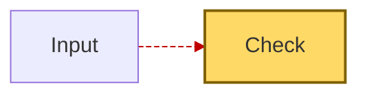
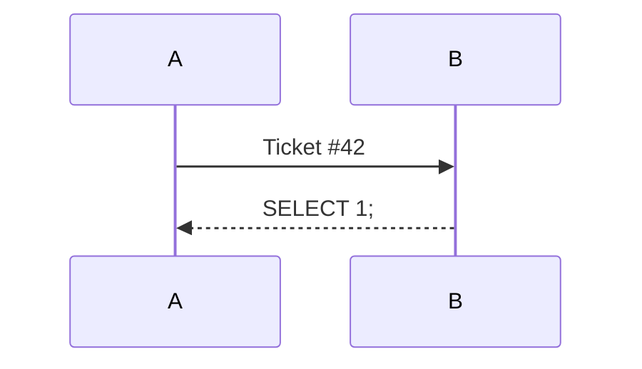
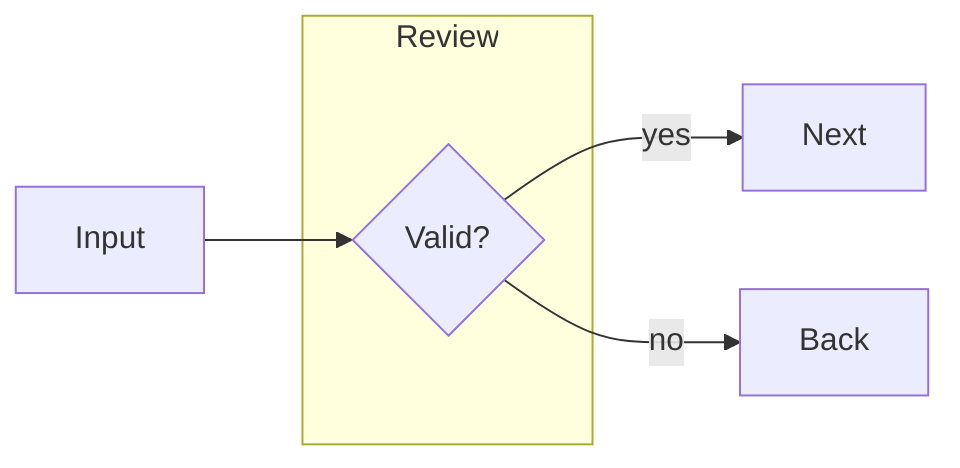
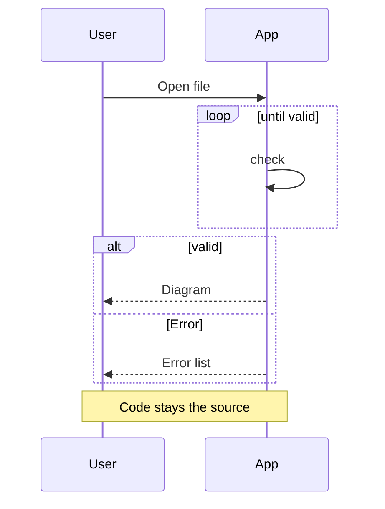
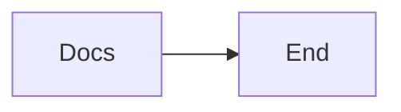

mermUId edits Mermaid diagrams graphically. The Mermaid code remains the file; the graphic is a second view of it. F1 opens this help, Esc closes it. The help header shows the app version.

## Keyboard shortcuts

Single-key shortcuts (C, G, arrow keys, Delete) work only when the canvas has focus and no inline editor is active. Ctrl shortcuts that override a browser function work only while focus is inside mermUId; outside the app, the browser function applies again. On macOS, Cmd stands for Ctrl.

| Action              | Shortcut                        | Note                                                                                                                                                                                                                                                                                                   |
| ------------------- | ------------------------------- | ------------------------------------------------------------------------------------------------------------------------------------------------------------------------------------------------------------------------------------------------------------------------------------------------------ |
| Save                | Ctrl-S                          | overridden: browser "Save page". File or download if the browser does not allow saving                                                                                                                                                                                                                 |
| Undo / Redo         | Ctrl-Z / Ctrl-Y or Ctrl-Shift-Z | Global; code changes count as one step per typing pause (500 ms)                                                                                                                                                                                                                                       |
| Delete              | Delete / Shift-Delete           | A node with edges asks once (can be turned off); Shift-Delete without asking, Undo is enough. Current behavior: Backspace also deletes                                                                                                                                                                 |
| Duplicate           | Ctrl-D                          | overridden: browser "Bookmark this page". Flowchart only: the copy is inserted with an offset; in sequence the browser function applies                                                                                                                                                                |
| Select all          | Ctrl-A                          | Flowchart only, when the canvas has focus; in sequence the browser function applies                                                                                                                                                                                                                    |
| Change selection    | Tab / Shift-Tab                 | Document order (next or previous element) only in flowchart; sequence: Tab moves through the elements in order, the focused element is selected and shows a focus frame                                                                                                                                |
| Move selection      | Arrow keys (Shift = 10x)        | Flowchart only; in sequence the arrow keys reorder (participants horizontally, other elements vertically), no Shift variant                                                                                                                                                                            |
| Connect to neighbor | Alt-Arrow                       | Flowchart only: connects to the nearest node in the arrow direction                                                                                                                                                                                                                                    |
| Inline edit         | F2 or double-click              | Enter applies, Shift-Enter inserts a line break, Esc cancels                                                                                                                                                                                                                                           |
| Start connecting    | C or drag from the handle       | Flowchart only: after C, arrow keys pick the target, Enter confirms, Esc cancels. With the mouse, drag from the handle on the node edge to the target node, no modifier key                                                                                                                            |
| Zoom                | Ctrl-Plus / Ctrl-Minus / Ctrl-0 | Flowchart and sequence, not in the code editor or an input field (the browser function applies there): Ctrl-0 fits the diagram; zoom 25 to 400 percent. Same effect with the "Zoom out", "Zoom in" and "Fit" buttons of the command bar. Fit leaves out the "Mermaid preview" card at the bottom right |
| Pan mode            | Hold Space                      | Flowchart: alternatively middle-click drag or mouse wheel; sequence: no pan mode, scrolling (mouse wheel, scroll bars) moves the view                                                                                                                                                                  |
| Grid / Snap         | G / Shift-G                     | Flowchart only: toggle, also with the "Grid" and "Snap" buttons of the command bar                                                                                                                                                                                                                     |
| Code panel          | Ctrl-E                          | overridden: browser search bar. Collapses and expands the code panel                                                                                                                                                                                                                                   |
| Search              | Ctrl-F                          | overridden: browser "Find on page". Searches the canvas                                                                                                                                                                                                                                                |
| Help                | F1                              | Opens this overview                                                                                                                                                                                                                                                                                    |
| Context menu        | Shift-F10 or Menu key           | Flowchart only: menu for the selection, usable with the arrow keys                                                                                                                                                                                                                                     |

## File and view

- New opens the "New diagram" dialog: choose diagram type (Flowchart, Sequence diagram) and template. Enter creates the current selection (default: empty flowchart); Esc cancels. New has no keyboard shortcut because the browser reserves Ctrl-N for a new window.
- With unsaved changes, New/Open/file drop asks: Save (default, Enter), Discard or Cancel (Esc). After Save, the action continues only if saving succeeded. If the browser then blocks the Open dialog, mermUId reports "Saved. Please choose Open again."
- Saving again while a save is in progress does not start another write.
- If the file was changed outside the app since it was opened or last saved, mermUId asks before saving: Save as (default, Enter), Overwrite or Cancel (Esc). Overwrite replaces the external change. If the file was moved, deleted or is no longer writable, Save opens Save as directly or downloads the file.
- Files must be UTF-8 (with or without BOM; an existing BOM is kept on save). Other encodings are not opened ("File is not a UTF-8 text file."). Maximum size 1 MB. The line ending (LF or CRLF) of an opened file is kept; new files get LF without BOM.
- The browser tab shows the file name, an asterisk marks unsaved changes.
- Success messages (e.g. Saved, Exported) disappear after a few seconds or with the next change. Error messages stay and are highlighted in red.
- The command bar above the canvas contains Undo, Redo, Select all, Layout (Auto, Manual), Direction (TD, LR), Align, Distribute, Grid, Snap and the zoom (Zoom out, zoom value, Zoom in, Fit). Select all, Layout, Direction, Align, Distribute, Grid and Snap exist only in flowchart; when disabled, Direction, Align and Distribute show the hint "Only available in flowcharts".
- "Align" needs at least 2, "Distribute" at least 3 selected nodes (edges do not count); otherwise the button is disabled. Both open the same entries as the context menu (e.g. "Align left", "Distribute horizontally").
- "Direction" sets the diagram direction: TD (top to bottom) or LR (left to right). Without a direction and with TB, TD is active.
- Without your own choice the theme follows the system setting (light/dark); the toggle stores a fixed choice.

## Code and diagram

- Invalid code shows an error notice on the canvas; the diagram shows the last valid state. Once the code is valid again, the diagram follows automatically. When opening a file with invalid code, the canvas stays empty until the code is valid. The status bar then shows "Sync: code invalid".
- Error list: entries for code errors show line, column and a short description. If Mermaid provides an exact message, it is behind "Details" (expand; "Hide details" collapses it).
- A conflict with the choices "Keep diagram", "Keep code" and "View diff" only arises when the diagram is changed while the code is invalid. The change applies to the diagram; the code text stays unchanged. The conflict remains until you choose, even if the code has become valid again in the meantime.
- "Keep diagram" rewrites the code from the diagram. "Keep code" discards the diagram changes and applies the code. Each choice is one undo step.

## Positions only in mermUId

Mermaid has no coordinates. mermUId stores manually set positions as the comment line `%% @mermuid: {...}` at the end of the diagram. The app manages this line; user comments stay untouched. The line may also appear further up; if there are several, the last one applies (with a warning). The next layout change writes exactly one line at the end of the diagram. If a line is inside an unsupported block (e.g. sequence `box` ... `end`), it stays there unchanged; the new line at the end applies.

- Manual positions apply only in mermUId and in mermUId's exports.
- Other renderers (GitHub, mermaid.live, Mermaid CLI) ignore the line and show Mermaid's own auto layout.
- Image exports (SVG, PNG) never contain the line. The "Embed layout" switch controls it when saving and for Copy as Markdown.
- Export dialog, source "Editor SVG": draws the diagram as on the canvas (flowchart and sequence). Options: "Colors of the active theme" (with background) and "Selection only" (flowchart; selected containers bring their content, edges only between selected elements).
- Export dialog, format PNG: "Background" fills the image, otherwise it stays transparent. "Color (empty: theme color)" accepts hex colors, color names (e.g. `white`), `rgb()`, `hsl()` or `transparent`; if empty or invalid, the theme background color applies. "Margin (px)" adds a margin of 0 to 512 px around the drawing (default 0); the scale enlarges it as well.
- Export dialog, "Copy SVG" or "Copy PNG": puts the image on the clipboard instead of downloading it (message e.g. "SVG copied to the clipboard."). If the browser cannot write images to the clipboard, the button is disabled and the dialog shows "This browser cannot write images to the clipboard."
- Positions exist only for flowchart. sequence derives its layout from the order.
- When a node is created by double-click or context menu in layout "Auto", mermUId stores no position for the new node; if needed, the view pans so that it is visible. In layout "Manual" the click position is kept.
- A subgraph without its own ID (title with spaces, e.g. `subgraph Two words` or `subgraph "Two words"`; `subgraph Check` has the ID `Check`) gets a fixed ID (e.g. `subgraph c3 [Two words]`) as soon as mermUId stores a position for it, so its position stays attached when more subgraphs are inserted before it. In layout "Auto" the first position change of any element (drag, arrow keys, align, distribute) or the first duplicate freezes the layout and switches to "Manual"; all subgraphs without their own ID then get a fixed ID. In layout "Manual" such a subgraph gets it the first time it is moved.

Example of a saved file:

```text
flowchart LR
  A[Start] --> B{Check}
  B -->|ok| C[Next]
%% @mermuid: {"v":1,"layout":"manual","pos":{"A":[40,60],"B":[220,60],"C":[400,60]}}
```

## Gaps per diagram type

In the MVP, flowchart and sequence can be edited graphically. All other types open as preview plus code (only as code).

| Type                | Editing      | Gaps                                                                                                                                                                                                                                             |
| ------------------- | ------------ | ------------------------------------------------------------------------------------------------------------------------------------------------------------------------------------------------------------------------------------------------ |
| flowchart (`graph`) | full         | `click` only as a Properties field, never executed. Metadata `A@{ ... }` stays in the code only                                                                                                                                                  |
| sequence            | full         | Nested blocks as a list instead of drawn freely. `box`, `break`, `create`, `destroy`, `autonumber` only in the code. Messages and notes with another statement after `;` only in the code. No duplicate, no context menu, no align or distribute |
| all other types     | only as code | Preview plus code panel with validation, no graphical editing                                                                                                                                                                                    |

Unknown or unsupported lines are kept unchanged when saving.

flowchart: Changed nodes are updated in place: shape and label in the node token of every shape-defining mention, an existing `style` or `click` line is replaced, otherwise one `class` line per added class and one new `style` or `click` line each is appended at the end of the diagram. Removed classes, cleared style and multiple `style` or `click` lines fall back to canonical rewriting.

sequence: Mermaid reads the text of a message or note only up to the first `#` or `;` (e.g. `A->>B: Ticket #42` shows "Ticket", `A->>B: SELECT 1;` shows "SELECT 1"). The canvas shows the same text and the code stays unchanged; only an edit on the canvas rewrites the line without the rest after `#`. If another statement follows the `;` (`A->>B: a; B->>A: b`), the line stays in the code only. To show `#` or `;`, write `#35;` for `#` and `#59;` for `;`. When you edit on the canvas, mermUId writes these characters that way itself.

sequence: A message or note text starting with `wrap:` or `nowrap:` toggles line wrapping and is not shown as text.

sequence: Participants introduced only via `A->>()B` (central connection) or `participant B@{ ... }` (metadata) cannot be edited on the canvas; it then reports "Unknown participant".

flowchart: An empty label becomes the ID (nodes and subgraphs); for example node `A` with a cleared label is written as `A`. Leading and trailing spaces and line breaks in labels are removed, as in Mermaid.

flowchart: Quoted labels may span several lines; `%%` lines inside them are comments and not part of the label. A single `"` without a counterpart (e.g. `A[5" screen]`) opens a label up to the end of the file; Mermaid rejects such code, the error list shows the error and the diagram stays at the last valid state.

flowchart: Markdown labels (backticks inside the quotes) are shown on the canvas as raw text including the backticks; Mermaid removes the backticks, trims the whitespace and formats the text.

flowchart: `style`, `classDef`/`class` and `linkStyle` color the canvas and the Editor SVG. Only hex colors (e.g. `#ffd966`) are allowed, stroke width 0.5 to 20, dash patterns as digits. mermUId would accept `rgb()`/`rgba()`, but Mermaid rejects them in flowchart styles as a syntax error. The canvas and the Editor SVG ignore color names (e.g. `red`) and other values; the code stays unchanged. Without `color`, the text color is derived from the fill (black or white, depending on contrast). Color fields (fill, line, text color) in flowcharts accept hex colors only (`#rgb`, `#rgba`, `#rrggbb`, `#rrggbbaa`). Color names and custom dash patterns (e.g. `3 1`) can still be set in the code. The color picker does not take an alpha part; the text field does.



sequence with special characters as entities:



flowchart with subgraph:



sequence with loop and alternative:



## Security: `click` directives

`click` directives are kept but never executed: no callbacks, no navigation. The Properties panel shows the directive as text. Depending on the link target:

- `http` and `https`: The preview (including in this help) shows the diagram, but the node is not a link; a click opens nothing. The Mermaid SVG keeps `http` or `https` targets as a link in the file; a program that opens the file later can follow it. Editor SVG and PNG contain no links.
- `javascript:`: Mermaid removes the link target. The diagram stays visible; the node is not a link.
- Other schemes (e.g. `mailto:`) and relative targets (e.g. `/foo`): mermUId rejects the whole diagram. Instead of the diagram, the preview and the Mermaid SVG export show the error message "SVG references an external resource".
- Preview and export always render with `securityLevel` strict.
- Labels are shown as text, never as HTML.
- Configuration in the code (`%%{init}%%`, frontmatter) cannot change security settings.

Example: The directive stays in the code; clicking "Docs" in the preview opens nothing.



## License

mermUId is released under the MIT License (Copyright (c) 2026 Nope-im-not-pro). The full text is in the LICENSE file in the program folder.
