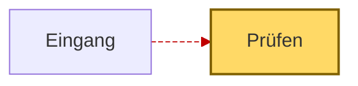
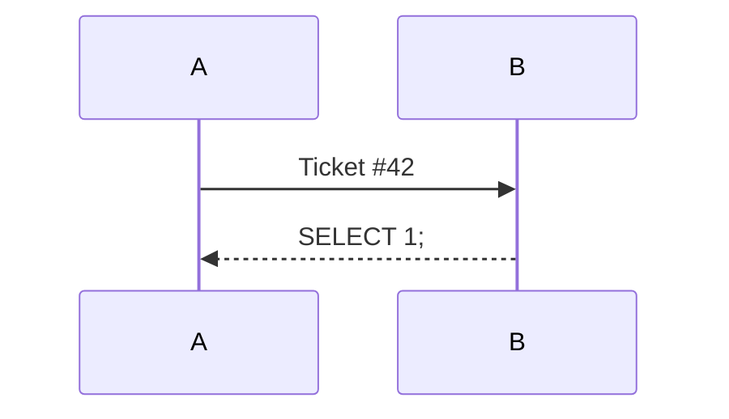
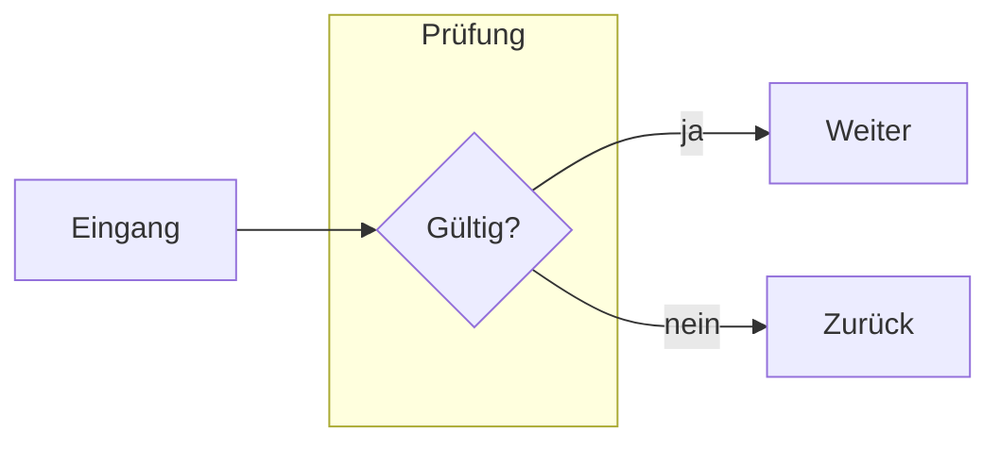
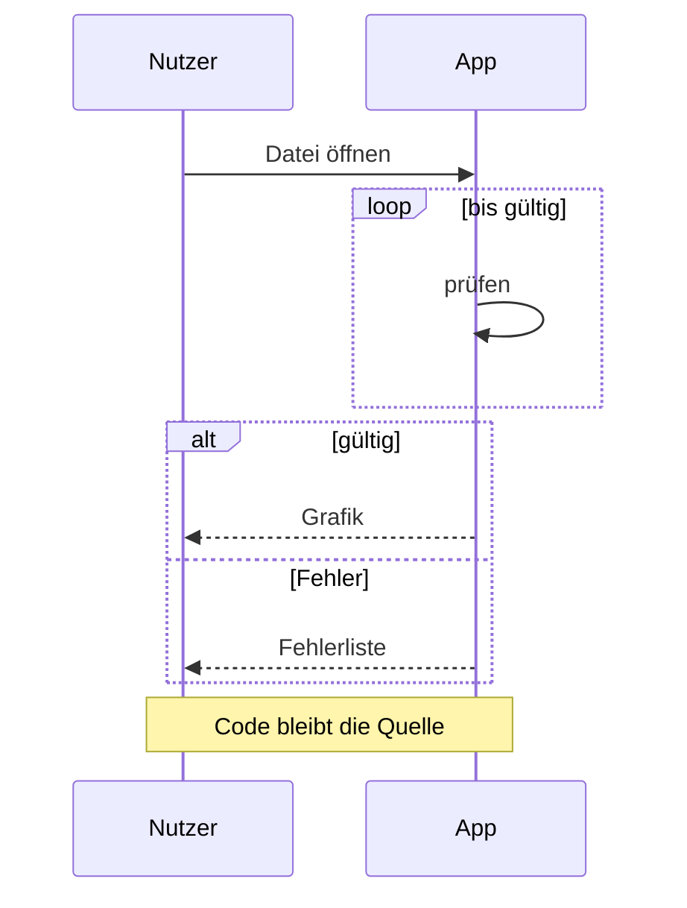
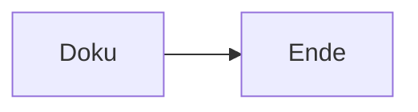

mermUId bearbeitet Mermaid-Diagramme grafisch. Der Mermaid-Code bleibt die Datei; die Grafik ist eine zweite Sicht darauf. F1 öffnet diese Hilfe, Esc schließt sie. Die Kopfzeile der Hilfe zeigt die Programmversion.

## Tastaturkürzel

Einzeltasten-Kürzel (C, G, Pfeiltasten, Entf) wirken nur bei fokussiertem Canvas und ohne aktiven Inline-Editor. Strg-Kürzel, die eine Browser-Funktion überdecken, wirken nur bei Fokus innerhalb von mermUId; außerhalb der App gilt wieder die Browser-Funktion. Auf macOS steht Cmd für Strg.

| Aktion                | Kürzel                            | Hinweis                                                                                                                                                                                                                                                                                                                       |
| --------------------- | --------------------------------- | ----------------------------------------------------------------------------------------------------------------------------------------------------------------------------------------------------------------------------------------------------------------------------------------------------------------------------- |
| Speichern             | Strg-S                            | überschrieben: Browser "Seite speichern". Datei oder Download, wenn der Browser kein Speichern erlaubt                                                                                                                                                                                                                        |
| Undo / Redo           | Strg-Z / Strg-Y oder Strg-Shift-Z | Global, Code-Änderungen zählen als ein Schritt pro Eingabepause (500 ms)                                                                                                                                                                                                                                                      |
| Löschen               | Entf / Shift-Entf                 | Knoten mit Kanten fragt einmalig nach (abschaltbar); Shift-Entf ohne Rückfrage, Undo genügt. Ist-Stand: auch Rücktaste (Backspace) löscht                                                                                                                                                                                     |
| Duplizieren           | Strg-D                            | überschrieben: Browser "Lesezeichen setzen". Nur flowchart: Kopie wird versetzt eingefügt; bei sequence gilt die Browser-Funktion                                                                                                                                                                                             |
| Alles auswählen       | Strg-A                            | Nur flowchart, bei fokussiertem Canvas; bei sequence gilt die Browser-Funktion                                                                                                                                                                                                                                                |
| Auswahl wechseln      | Tab / Shift-Tab                   | Nur flowchart nach Dokument-Reihenfolge (nächstes oder vorheriges Element); sequence: Tab führt der Reihe nach durch die Elemente, das fokussierte Element ist ausgewählt und trägt einen Fokusrahmen                                                                                                                         |
| Auswahl verschieben   | Pfeiltasten (Shift = 10-fach)     | Nur flowchart; bei sequence sortieren die Pfeiltasten um (Teilnehmer waagerecht, übrige Elemente senkrecht), ohne Shift-Variante                                                                                                                                                                                              |
| Mit Nachbar verbinden | Alt-Pfeil                         | Nur flowchart: verbindet mit dem nächsten Knoten in Pfeilrichtung                                                                                                                                                                                                                                                             |
| Inline-Edit           | F2 oder Doppelklick               | Enter übernimmt, Shift-Enter bricht die Zeile um, Esc bricht ab                                                                                                                                                                                                                                                               |
| Verbinden starten     | C oder Ziehen vom Handle          | Nur flowchart: nach C wählen Pfeiltasten das Ziel, Enter bestätigt, Esc bricht ab. Mit der Maus vom Anfasser (Handle) am Knotenrand auf den Zielknoten ziehen, ohne Zusatztaste                                                                                                                                               |
| Zoom                  | Strg-Plus / Strg-Minus / Strg-0   | flowchart und sequence, nicht im Code-Editor oder in einem Eingabefeld (dort gilt die Browser-Funktion): Strg-0 passt das Diagramm ein; Zoom 25 bis 400 Prozent. Gleiche Wirkung über die Knöpfe "Verkleinern", "Vergrößern" und "Einpassen" der Befehlsleiste. Einpassen spart die Karte "Mermaid-Vorschau" unten rechts aus |
| Pan-Modus             | Leertaste halten                  | flowchart: alternativ Mittelklick-Drag oder Mausrad; sequence: kein Pan-Modus, Scrollen (Mausrad, Bildlaufleisten) verschiebt die Ansicht                                                                                                                                                                                     |
| Grid / Snap           | G / Shift-G                       | Nur flowchart: umschalten, auch über die Knöpfe "Raster" und "Einrasten" der Befehlsleiste                                                                                                                                                                                                                                    |
| Code-Panel            | Strg-E                            | überschrieben: Browser-Suchleiste. Klappt das Code-Panel ein und aus                                                                                                                                                                                                                                                          |
| Suche                 | Strg-F                            | überschrieben: Browser "Suchen auf der Seite". Sucht im Canvas                                                                                                                                                                                                                                                                |
| Hilfe                 | F1                                | Öffnet diese Übersicht                                                                                                                                                                                                                                                                                                        |
| Kontextmenü           | Shift-F10 oder Kontextmenü-Taste  | Nur flowchart: Menü für die Auswahl, mit Pfeiltasten bedienbar                                                                                                                                                                                                                                                                |

## Datei und Ansicht

- Neu öffnet den Dialog "Neues Diagramm": Diagrammtyp (Flussdiagramm, Sequenzdiagramm) und Vorlage wählen. Enter legt die aktuelle Auswahl an (Standard: leeres Flussdiagramm); Esc bricht ab. Neu hat kein Tastaturkürzel, weil der Browser Strg-N für ein neues Fenster reserviert.
- Bei ungespeicherten Änderungen fragt Neu/Öffnen/Datei-Drop: Speichern (Standard, Enter), Verwerfen oder Abbrechen (Esc). Die Aktion läuft nach Speichern nur weiter, wenn das Speichern gelungen ist. Blockiert der Browser danach den Öffnen-Dialog, meldet mermUId "Gespeichert. Bitte Öffnen erneut wählen."
- Ein zweites Speichern während eines laufenden Speicherns startet keinen weiteren Schreibvorgang.
- Wurde die Datei seit dem Öffnen oder letzten Speichern außerhalb der App geändert, fragt mermUId vor dem Speichern: Speichern unter (Standard, Enter), Überschreiben oder Abbrechen (Esc). Überschreiben ersetzt die externe Änderung. Ist die Datei verschoben, gelöscht oder nicht mehr beschreibbar, öffnet Speichern direkt Speichern unter bzw. lädt die Datei herunter.
- Dateien müssen UTF-8 sein (mit oder ohne BOM; ein vorhandenes BOM bleibt beim Speichern erhalten). Andere Kodierungen werden nicht geöffnet ("Datei ist keine UTF-8-Textdatei."). Höchstgröße 1 MB. Das Zeilenende (LF oder CRLF) einer geöffneten Datei bleibt erhalten, neue Dateien erhalten LF ohne BOM.
- Der Browser-Tab zeigt den Dateinamen, ein Stern markiert ungespeicherte Änderungen.
- Erfolgsmeldungen (z. B. Gespeichert, Exportiert) verschwinden nach einigen Sekunden oder bei der nächsten Änderung. Fehlermeldungen bleiben stehen und sind rot hervorgehoben.
- Die Befehlsleiste über dem Canvas enthält Rückgängig, Wiederholen, Alles auswählen, Layout (Auto, Manuell), Richtung (TD, LR), Ausrichten, Verteilen, Raster, Einrasten und den Zoom (Verkleinern, Zoomwert, Vergrößern, Einpassen). Alles auswählen, Layout, Richtung, Ausrichten, Verteilen, Raster und Einrasten gibt es nur im flowchart; gesperrt zeigen Richtung, Ausrichten und Verteilen den Hinweis "Nur im Flowchart verfügbar".
- "Ausrichten" braucht mindestens 2, "Verteilen" mindestens 3 ausgewählte Knoten (Kanten zählen nicht); sonst ist der Knopf gesperrt. Beide öffnen dieselben Einträge wie das Kontextmenü (z. B. "Links ausrichten", "Horizontal verteilen").
- "Richtung" setzt die Diagrammrichtung: TD (von oben nach unten) oder LR (von links nach rechts). Ohne Richtungsangabe und bei TB ist TD aktiv.
- Ohne eigene Wahl folgt das Farbschema der Systemeinstellung (hell/dunkel); der Schalter speichert eine feste Wahl.

## Code und Grafik

- Ungültiger Code zeigt einen Fehlerhinweis auf der Zeichenfläche; die Grafik zeigt den letzten gültigen Stand. Ist der Code wieder gültig, folgt die Grafik automatisch. Beim Öffnen einer Datei mit ungültigem Code bleibt die Fläche leer, bis der Code gültig ist. Die Statusleiste zeigt dann "Sync: Code ungültig".
- Fehlerliste: Einträge zu Code-Fehlern zeigen Zeile, Spalte und eine kurze Beschreibung. Liefert Mermaid eine genaue Meldung, steht sie hinter "Details" (aufklappen, "Details ausblenden" klappt wieder zu).
- Ein Konflikt mit den Wahlen "Grafik behalten", "Code behalten", "Diff ansehen" entsteht erst, wenn die Grafik bei ungültigem Code geändert wird. Die Änderung wirkt in der Grafik, der Code-Text bleibt unverändert. Der Konflikt bleibt bis zur Wahl bestehen, auch wenn der Code inzwischen wieder gültig ist.
- "Grafik behalten" schreibt den Code neu aus der Grafik. "Code behalten" verwirft die Grafik-Änderungen und übernimmt den Code. Beide Wahlen sind ein Undo-Schritt.

## Positionen nur in mermUId

Mermaid kennt keine Koordinaten. Manuell gesetzte Positionen speichert mermUId als Kommentarzeile `%% @mermuid: {...}` am Ende des Diagramms. Die Zeile verwaltet die App; Nutzer-Kommentare bleiben unberührt. Die Zeile darf auch weiter oben stehen; bei mehreren gilt die letzte (mit Warnung). Die nächste Layout-Änderung schreibt genau eine Zeile ans Ende des Diagramms. Steht eine Zeile in einem nicht unterstützten Block (z. B. sequence `box` ... `end`), bleibt sie dort unverändert stehen; die neue Zeile am Ende gilt.

- Manuelle Positionen wirken nur in mermUId und in den Exporten von mermUId.
- Fremde Renderer (GitHub, mermaid.live, Mermaid-CLI) ignorieren die Zeile und zeigen das Mermaid-eigene Auto-Layout.
- Bildexporte (SVG, PNG) enthalten die Zeile nie. Der Schalter "Layout einbetten" steuert sie beim Speichern und bei Copy-as-Markdown.
- Export-Dialog, Quelle "Editor-SVG": zeichnet das Diagramm wie im Canvas (flowchart und sequence). Optionen: "Farben des aktiven Themes" (mit Hintergrund) und "Nur Auswahl" (flowchart; ausgewählte Container bringen ihren Inhalt mit, Kanten nur zwischen ausgewählten Elementen).
- Export-Dialog, Format PNG: "Hintergrund" füllt das Bild, sonst bleibt es transparent. "Farbe (leer: Theme-Farbe)" nimmt Hex-Farben, Farbnamen (z. B. `white`), `rgb()`, `hsl()` oder `transparent` an; leer oder ungültig gilt die Hintergrundfarbe des Themes. "Rand (px)" legt einen Rand von 0 bis 512 px um die Zeichnung (Standard 0); der Maßstab vergrößert ihn mit.
- Export-Dialog, "SVG kopieren" bzw. "PNG kopieren": legt das Bild in die Zwischenablage statt es herunterzuladen (Meldung z. B. "SVG in die Zwischenablage kopiert."). Kann der Browser keine Bilder in die Zwischenablage schreiben, ist der Knopf gesperrt und der Dialog zeigt "Dieser Browser kann keine Bilder in die Zwischenablage schreiben."
- Positionen gibt es nur für flowchart. sequence leitet das Layout aus der Reihenfolge ab.
- Beim Anlegen eines Knotens per Doppelklick oder Kontextmenü speichert mermUId im Layout "Auto" keine Position für den neuen Knoten; falls nötig, wird die Ansicht verschoben, damit er sichtbar ist. Im Layout "Manuell" bleibt die Klickposition erhalten.
- Ein Subgraph ohne eigene ID (Titel mit Leerzeichen, z. B. `subgraph Zwei Worte` oder `subgraph "Zwei Worte"`; `subgraph Prüfung` hat die ID `Prüfung`) erhält eine feste ID (z. B. `subgraph c3 [Zwei Worte]`), sobald mermUId eine Position für ihn speichert, damit seine Position erhalten bleibt, wenn davor weitere Subgraphen eingefügt werden. Im Layout "Auto" friert die erste Positionsänderung eines beliebigen Elements (Ziehen, Pfeiltasten, Ausrichten, Verteilen) oder das erste Duplizieren das Layout ein und schaltet auf "Manuell"; dabei erhalten alle Subgraphen ohne eigene ID eine feste ID. Im Layout "Manuell" erhält ein solcher Subgraph sie beim ersten Verschieben.

Beispiel einer gespeicherten Datei:

```text
flowchart LR
  A[Start] --> B{Prüfen}
  B -->|ok| C[Weiter]
%% @mermuid: {"v":1,"layout":"manual","pos":{"A":[40,60],"B":[220,60],"C":[400,60]}}
```

## Lücken je Diagrammtyp

Im MVP sind flowchart und sequence grafisch bearbeitbar. Alle anderen Typen öffnen als Vorschau plus Code (nur Code).

| Typ                 | Bearbeitung | Lücken                                                                                                                                                                                                                                                              |
| ------------------- | ----------- | ------------------------------------------------------------------------------------------------------------------------------------------------------------------------------------------------------------------------------------------------------------------- |
| flowchart (`graph`) | voll        | `click` nur als Eigenschaften-Feld, ohne Ausführung. Metadaten `A@{ ... }` bleiben nur im Code                                                                                                                                                                      |
| sequence            | voll        | Verschachtelte Blöcke als Liste statt frei gezeichnet. `box`, `break`, `create`, `destroy`, `autonumber` nur im Code. Nachrichten und Notizen mit einer weiteren Anweisung nach `;` nur im Code. Kein Duplizieren, kein Kontextmenü, kein Ausrichten oder Verteilen |
| alle anderen Typen  | nur Code    | Vorschau plus Code-Panel mit Validierung, keine grafische Bearbeitung                                                                                                                                                                                               |

Unbekannte oder nicht unterstützte Zeilen bleiben beim Speichern unverändert erhalten.

flowchart: Geänderte Knoten werden in place nachgezogen: Form und Label im Knoten-Token jeder formgebenden Nennung, eine vorhandene `style`- oder `click`-Zeile wird ersetzt, sonst kommt je hinzugefügter Klasse eine `class`-Zeile und je eine neue `style`- bzw. `click`-Zeile ans Ende des Diagramms. Entfernte Klassen, geleerter Style und mehrere `style`- oder `click`-Zeilen führen zum kanonischen Neuschreiben.

sequence: Mermaid liest den Text einer Nachricht oder Notiz nur bis zum ersten `#` oder `;` (z. B. `A->>B: Ticket #42` zeigt "Ticket", `A->>B: SELECT 1;` zeigt "SELECT 1"). Der Canvas zeigt denselben Text, der Code bleibt unverändert; erst eine Bearbeitung im Canvas schreibt die Zeile ohne den Rest nach `#` neu. Steht nach `;` eine weitere Anweisung (`A->>B: a; B->>A: b`), bleibt die Zeile nur im Code. Damit `#` oder `;` sichtbar werden: `#35;` für `#` und `#59;` für `;` schreiben. Beim Bearbeiten im Canvas schreibt mermUId diese Zeichen selbst so.

sequence: Beginnt der Text einer Nachricht oder Notiz mit `wrap:` oder `nowrap:`, schaltet das den Zeilenumbruch und erscheint nicht im Text.

sequence: Teilnehmer, die nur über `A->>()B` (zentrale Verbindung) oder `participant B@{ ... }` (Metadaten) eingeführt werden, kann der Canvas nicht bearbeiten, er meldet dann "Unbekannter Teilnehmer".

flowchart: Ein leeres Label wird zur ID (Knoten und Subgraphen), z. B. wird Knoten `A` mit geleertem Label als `A` geschrieben. Führende und abschließende Leerzeichen und Zeilenumbrüche in Labels entfallen wie in Mermaid.

flowchart: Labels in Anführungszeichen dürfen über mehrere Zeilen gehen; `%%`-Zeilen darin zählen als Kommentar und gehören nicht zum Label. Ein einzelnes `"` ohne Gegenstück (z. B. `A[5" screen]`) öffnet ein Label bis zum Dateiende; Mermaid lehnt solchen Code ab, die Fehlerliste zeigt den Fehler und die Grafik bleibt beim letzten gültigen Stand.

flowchart: Markdown-Labels (Backticks innerhalb der Anführungszeichen) zeigt der Canvas als Rohtext samt Backticks; Mermaid entfernt die Backticks, kürzt den Leerraum und formatiert den Text.

flowchart: `style`, `classDef`/`class` und `linkStyle` färben Canvas und Editor-SVG. Erlaubt sind nur Hex-Farben (z. B. `#ffd966`), Strichstärke 0.5 bis 20, Strichmuster als Ziffern. `rgb()`/`rgba()` ließe mermUId zu, Mermaid lehnt es in flowchart-Stilen aber als Syntaxfehler ab. Farbnamen (z. B. `red`) und andere Werte ignorieren Canvas und Editor-SVG; der Code bleibt unverändert. Ohne `color` wird die Textfarbe aus der Füllung abgeleitet (Schwarz oder Weiß, je nach Kontrast). Farbfelder (Füll-, Linien-, Textfarbe) im flowchart nehmen nur Hex-Farben an (`#rgb`, `#rgba`, `#rrggbb`, `#rrggbbaa`). Farbnamen und eigene Strichmuster (z. B. `3 1`) bleiben im Code setzbar. Der Farbwähler übernimmt keinen Alpha-Anteil, das Textfeld schon.



sequence mit Sonderzeichen als Entity:



flowchart mit Subgraph:



sequence mit Schleife und Alternative:



## Sicherheit: `click`-Direktiven

`click`-Direktiven werden erhalten, aber nie ausgeführt: keine Callbacks, keine Navigation. Im Eigenschaften-Panel steht die Direktive als Text. Je nach Link-Ziel gilt:

- `http` und `https`: Die Vorschau (auch in dieser Hilfe) zeigt das Diagramm, der Knoten ist aber kein Link, ein Klick öffnet nichts. Das Mermaid-SVG übernimmt Ziele mit `http` oder `https` als Verweis in die Datei; ein Programm, das die Datei später öffnet, kann ihm folgen. Editor-SVG und PNG enthalten keine Links.
- `javascript:`: Mermaid entfernt das Link-Ziel. Das Diagramm bleibt sichtbar, der Knoten ist kein Link.
- Andere Schemata (z. B. `mailto:`) und relative Ziele (z. B. `/foo`): mermUId weist das ganze Diagramm ab. Vorschau und Mermaid-SVG-Export zeigen statt des Diagramms die Fehlermeldung "SVG verweist auf externe Ressource".
- Vorschau und Export rendern immer mit `securityLevel` strict.
- Labels werden als Text dargestellt, nie als HTML.
- Konfiguration im Code (`%%{init}%%`, Frontmatter) kann Sicherheitseinstellungen nicht ändern.

Beispiel: Die Direktive bleibt im Code, ein Klick auf "Doku" in der Vorschau öffnet nichts.



## Lizenz

mermUId steht unter der MIT-Lizenz (Copyright (c) 2026 Nope-im-not-pro). Der vollständige Text liegt als Datei LICENSE im Programmordner.
